# User Guide

This guide is the labelled (isotope-tracing) workflow: M+0…M+n channels,
natural-abundance correction, and label-derived exports. For a one-page path, see
[Quick Start](00_quick_start.md). For targeted
profiling without stable-isotope tracing, start an **Unlabelled** session and
use [Unlabelled Targeted Analysis](Unlabelled_Targeted_Analysis.md).

## Step 1: Load Compound Definitions

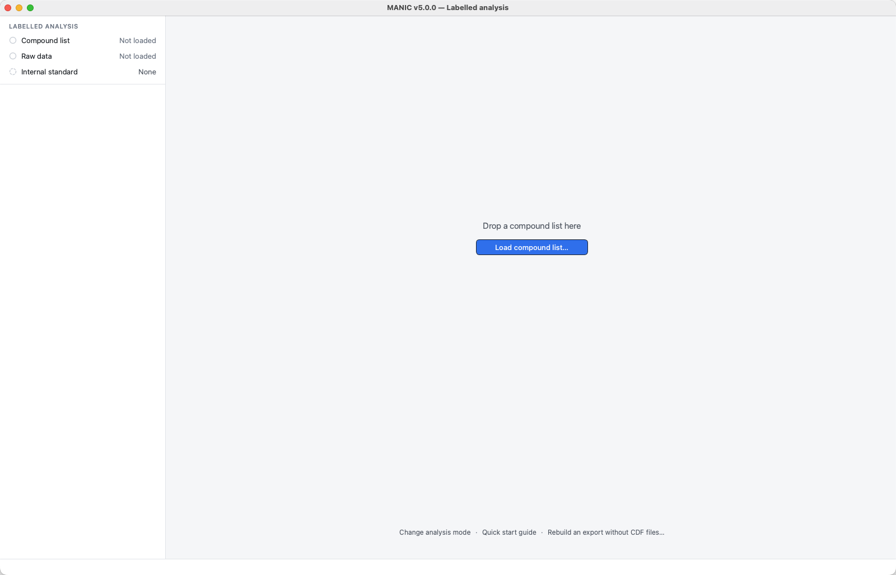

**File Requirements**   

Prepare an Excel (`.xlsx`, `.xls`) or CSV (`.csv`) file containing the columns listed below.

*Note: Column headers are flexible. They are case-insensitive and ignore spaces or underscores (e.g., `Int Std Amount`, `int_std_amount`, and `IntStdAmount` are all treated as the same field).*

| Column | Description |
| :--- | :--- |
| `name` | Unique compound identifier |
| `tr` | Retention time (minutes) |
| `mass0` | Base m/z value |
| `loffset` | Left integration offset (minutes) from tR |
| `roffset` | Right integration offset (minutes) from tR |
| `labelatoms` | Number of positions capable of retaining label |
| `formula` | Molecular formula (e.g., C6H12O6) |
| `labeltype` | Element being labeled (e.g., C) |
| `tbdms` | Number of TBDMS derivatization groups |
| `meox` | Number of Methoxyamine derivatization groups |
| `me` | Number of Methylation groups |
| `amount_in_std_mix`| Concentration in standard mixture |
| `int_std_amount` | Amount of internal standard added to samples |
| `mmfiles` | Pattern to identify MM files (standard mixture). Supports wildcards like `*MM*` |

> **Tip:** To see a working template, download the `example_compound_list.xls` file from the repository.

**Procedure**

1.  Navigate to **File → Load Compounds/Parameter List**.
2.  Select your prepared compound definition file from the file dialog.

**Verification**

* The **Compound list** row at the top of the sidebar shows a green check, and the **Compounds** heading shows the number of compounds.
* The **Compounds** list in the sidebar fills with the names of all imported compounds.

*If any required columns are missing from your file, the import process will be cancelled and an alert will display the specific missing headers.*

**Add Compound**  

To add one compound without a spreadsheet, choose **File → Add Compound...** or right-click the compound list and choose **Add Compound...**. The form uses the same fields as a compound-list row for this session. Blank offsets and counts mean 0. Click **Add compound**. If a required field is missing, MANIC marks every missing field at once and keeps the form open. After the compound is added, the new name appears in the list. If no CDF samples are loaded, it is selected straight away. If CDF samples are already loaded, MANIC extracts EICs for that compound by re-reading the original CDF files from the location they were first imported from, then selects and plots it when extraction finishes. If those files have moved, the compound is still saved but has no chromatogram data; restore the files and widen an integration boundary to trigger re-extraction, or add compounds before importing raw data. A name that already exists, including a deleted compound, is rejected. Recover the deleted compound or choose a different name.

---

## Step 2: Import Mass Spectrometry Data

**Prerequisites**   

* **Compound Definitions Loaded:** You must complete [Step 1](#step-1-load-compound-definitions) first. The application requires the compound library to know which masses to extract.
* **File Format:** ANDI/AIA NetCDF (`.cdf` in any case). Each file must provide `scan_acquisition_time`, `mass_values`, `intensity_values`, `scan_index`, `point_count`, and `total_intensity`.
* **Conversion:** MANIC does not import vendor mass-spec files. Convert them to CDF in [OpenChrom](https://www.openchrom.net/) first.
* **File Organization:** Put every CDF for the experiment (samples and MM files (standard mixture)) in one folder. MANIC scans that folder for `*.cdf` in any case.

**Configuration Note**   

The import process uses the global **Mass Tolerance** setting (Default: 0.2 Da) to bin detected masses.

* To check or change this: Go to **Settings → Extraction**, **Mass tolerance (Da)**, before or after loading data.
* If CDFs are already loaded, changing the tolerance regenerates every EIC. You do not re-import the folder.

**Procedure**   

1.  Navigate to **File → Load Raw Data (CDF)**.
2.  In the dialog window, select the **Directory (Folder)** containing your CDF files.
    * *Note: You are selecting the folder itself, not individual files.*
3.  Click **Select Folder** to begin the import.

A progress bar will appear as the application:   

1.  Reads CDF files.
2.  Extracts ion chromatograms for each defined compound.
3.  Stores EIC data in the local database.
4.  Calculates and applies natural abundance corrections.

**Verification**   

* The **Raw data** row at the top of the sidebar shows a green check, and the **Samples** heading shows the number of samples.
* Expand **Samples** in the sidebar to see the filenames of your imported samples.
* Selecting a compound shows one plot per sample in the main view.

---

## Step 3: Configure Internal Standard

After the import finishes, MANIC opens a **Check your data setup** dialog. It shows the internal standard and whether each compound's `mmfiles` pattern matches any loaded sample. Weak peaks are flagged only when an internal standard is set. Click **Continue** to keep the setup as it is. If you choose a different internal standard in the dialog, click **Apply** to use it, or **Continue without changes** to keep the current one. Run the same check later from **Help → Check Data Setup...**. The dialog names the loaded compound list with **Open File** and **Show in Folder**.

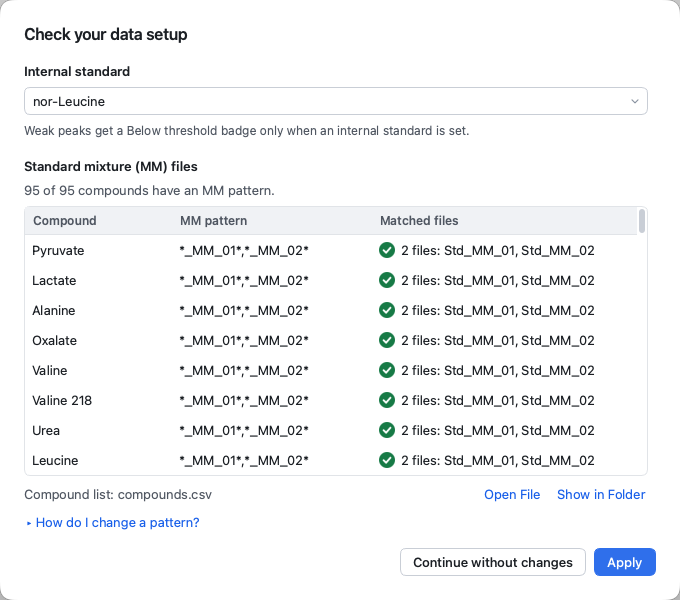

**Changing an MM pattern.** Click **How do I change a pattern?** under the table for the short version. For a compound already in the list, edit its `mmfiles` cell in the compound list file, choose **File → Clear Session**, then load the compound list and the raw data again. Clear Session also removes the internal standard, integration changes, peak reviews, curve-fit choices and any compounds added with **Add Compound**, so fix patterns before you review. Importing a session exported earlier brings its old patterns back. For a compound not in the list, use **File → Add Compound...**, which sets its pattern without reloading.

**Prerequisites**   

The internal standard is the reference compound for normalization and quantification (MRRF calculation). It must meet these criteria in your compound definition file (from Step 1):

* **Unlabeled:** `labelatoms` should be `0`.
* **Sample Dose:** `int_std_amount` must be defined and `> 0`. This is the amount added to every experimental sample.
* **Calibration Amount:** `amount_in_std_mix` must be defined and `> 0`. This is the concentration present in the standard mixture (MM) files.
* **Universal Presence:** The compound must be detectable in all samples and standards.

**Procedure**   

1.  Click the **Internal standard** row at the top of the sidebar.
2.  Type to filter the list, then click the compound or press Return. Compounds without both amounts are listed last, under **No amount: exports peak areas**.
3.  To remove a selection, open the same list and choose **No internal standard**.

You can also right-click a compound in the **Compounds** list and choose **Select as Internal Standard**, or right-click anywhere in the list and choose **Clear Internal Standard**. **Settings → Internal standard** names the chosen standard and sets its reference peak; click **Save** to apply a new reference peak.

**Verification**

* **Standard selected:** The **Internal standard** row shows the compound name. If the compound list gives it no amount, the row turns amber with an exclamation mark, and export writes peak areas; hover the row for the reason.
* **No standard:** The row shows **None**. An internal standard is optional.

The compound you are reviewing is highlighted in the **Compounds** list and named in the heading above the plot grid.

---

## Step 4: Review Integration

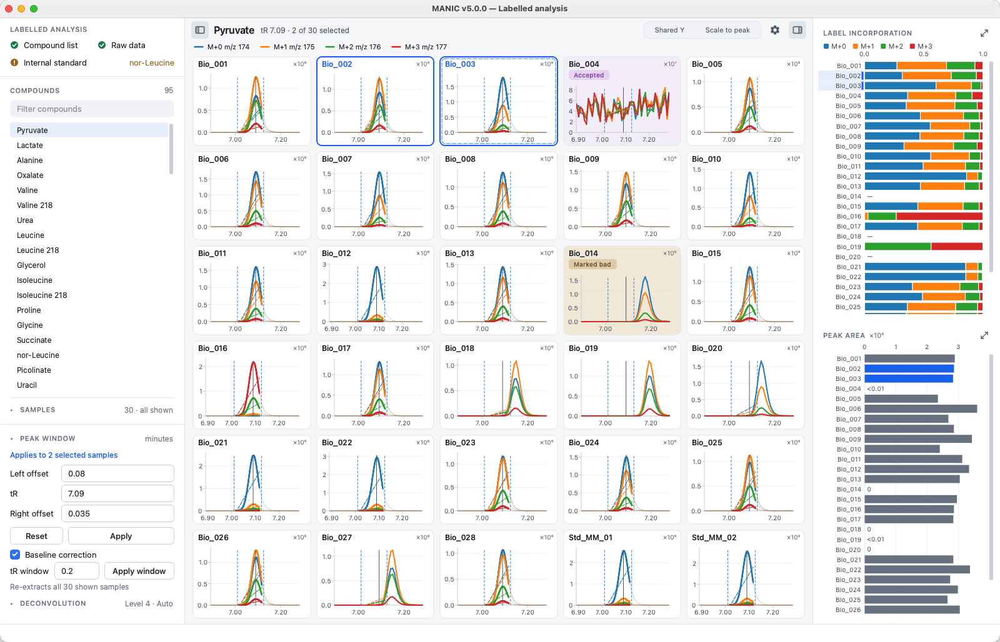

**The Main Graph View**   

Selecting a compound shows a grid of mini-plots, one for each sample ticked in the **Samples** section. The plots shrink to keep every sample on screen; with more samples than fit at a readable size, the grid scrolls. The heading above the grid names the compound and its tR. Once you select plots it adds how many, for example **3 of 30 selected**. The **Samples** heading in the sidebar counts the samples shown.

* **Grey solid line:** The expected retention time (`tR`).
* **Blue dashed lines:** The integration boundaries (`tR - loffset` and `tR + roffset`).
* **Badges** (coloured like the exported workbook's cells):
    * **No badge:** The area meets the threshold, or no internal standard is set, so it was not checked.
    * **Below threshold** (light red badge and tile): Weak peak. The area is below 0.5% of the internal standard reference peak, unless you change **Minimum area ratio** in **Settings → Peak validation**.
    * **Accepted** (light purple) or **Marked bad** (tan): You reviewed a weak peak from the **Review** menu or the plot right-click menu.
* **Blue outline:** The plot is selected for editing.

Click **Shared Y** in the grid header, or choose **View → Shared Y-Scale**, to use one common intensity scale for all sample tiles. Choose it again to let each tile autoscale to its own tallest peak.

**Procedure**

#### 1. Visual Inspection
Scan the grid of plots. Look for:

* **Peak Centering:** Is the peak centered on the grey line? If retention times have shifted, you may need to adjust the `tR`.
* **Peak Coverage:** Do the blue dashed lines fully bracket the peak without cutting off "tails" or including neighboring noise?
* **Validation:** Pay attention to plots with a **Below threshold** badge. These indicate potential issues (low signal or missed peaks) that require manual review. Right-click the plot, or open the **Review** menu, and choose **Accept Peak (Below Threshold)** or **Mark Peak as Bad** to record your decision. With several plots selected, both commands act on the whole selection and name the count, for example **Mark 3 Peaks as Bad**. Choose the same command again to clear the decision.

#### 2. Detailed Inspection (Optional)
For ambiguous peaks, inspecting the raw data more closely might be helpful:

1.  **Right-click** on any specific plot in the grid.
2.  Select **Inspect *sample*...**. Double-clicking a plot, or pressing Return on the focused plot, does the same.
3.  A window will open showing three synchronized views:
    * **Extracted ion chromatogram (EIC):** Zoomable view of the peak.
    * **Total ion chromatogram (TIC):** To see global elution context.
    * **Mass spectrum:** The actual mass spectrum at compound retention time.
4.  Use the toolbar to **Zoom (🔍)** or **Pan (✋)**.

#### 3. Selecting Samples to Adjust
You can adjust integration parameters for all samples at once or for specific outliers.

* **Edit All:** Right-click a plot and choose **Deselect All**. With nothing selected, **Apply** and **Reset** change every shown sample.
* **Edit Specific Samples:** Click on individual plots to select them (they get a blue outline). Drag a box to select several. The **Peak window** section shows "Applies to N selected samples", or the sample's name for one. Changes apply *only* to the selection.
* **Show Only Selected Samples:** Right-click a selected plot and choose this command to hide every other sample. The remaining tiles stay selected. If you right-click a plot that is not selected, the command uses that plot alone.
* **Show All Samples:** Right-click and choose this command to show every sample again with no plots selected, the same as when you first load a compound.
* **Samples list:** Untick a sample in the **Samples** section of the sidebar to hide its plot, and tick it to show it again. Type in **Filter samples** to narrow the list. While a filter is set, the section heading reads **k shown · n match**.

**Review menu.** The **Review** menu in the menu bar holds the plot right-click menu's selection and review commands, so you can review from the keyboard. Its commands act on the selected plots, led by the focused plot, or on the focused plot when nothing is selected. Labels name the count, for example **Curve Fit for 3 Samples**.

* **Inspect *sample*...** (Return)
* **Select All Plots** (Ctrl+A, ⌘A on macOS), **Deselect All** (Esc), **Show Only Selected Samples**, **Show All Samples**
* **Accept Peak (Below Threshold)**, **Mark Peak as Bad**, and the **Curve Fit** submenu

Click a plot so the grid has keyboard focus. Move the focus between plots with the arrow keys and press Space to select or deselect the focused plot.

#### 4. Adjusting Boundaries (Peak window)
Locate the **Peak window** section of the sidebar, below the compound list.

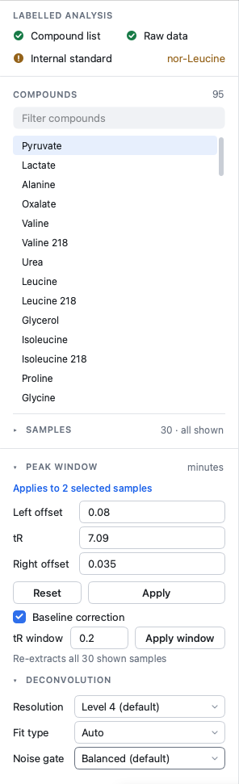

On a short window, such as a laptop screen with **Samples** open, the rows under **Apply** fold behind a **Baseline, tR window** heading. Click it to open those rows beside the sidebar.

* **Left offset / Right offset:** Controls the width of the window. Increase these to capture wider peaks; decrease to exclude adjacent peaks.
* **tR:** Shifts the center of the window. Use this to align the window with shifted peaks.

*Note: If multiple samples are selected with different values, the fields will display a range (e.g., `0.2 - 0.4`). Typing a new value will overwrite all selected samples with that single value. A field you leave as a range keeps each sample's own value when you click **Apply**.*

#### 5. Applying Changes
1.  Enter your new values in the text fields.
2.  Click **Apply**, or press Enter in a field. With plots selected, the line above the fields names them; with none selected, **Apply** changes every shown sample.
3.  The plots will refresh immediately to show the new boundaries.

> **Auto-Regeneration Feature:** If you widen the boundaries beyond the data MANIC originally extracted from the CDF file, the software will automatically re-read the raw file to fetch the missing data. A progress bar will appear during this process.

#### 6. Troubleshooting: Fixing Cut-off Peaks
Sometimes a peak may shift so far that part of it is completely missing from the plot (cut off by the edge of the extracted data). You cannot integrate what isn't there.

To fix this, you must widen the underlying data extraction window:

1.  Locate the **tR window** field in the **Peak window** section.
2.  Increase the value (e.g., from `0.2` to `0.4` or `0.5`).
3.  Click **Apply window**. The line under the field names how many samples it re-extracts, for example **Re-extracts all 30 shown samples**.

If the shown samples hold different windows, the field shows the range, for example `0.3 - 0.8`. **Apply window** then asks for one value. When **Apply** has to re-extract samples, it uses the widest window among them, so a sample with a narrower window is widened.

The extract must cover the current left and right offsets plus the RT window buffer (0.1 min by default). If the typed tR window sits inside those offsets, MANIC raises it to that minimum, updates the field, and continues.

A progress bar will appear as MANIC re-scans the raw CDF files to extract a wider slice of time around the target peak.

> **Important Note:** This update applies to **every sample shown in the grid** for the currently selected compound, whichever plots are selected, to ensure consistent data extraction. It does *not* affect other compounds in your library.

#### 7. Resetting Overrides
If you make a mistake or want to revert to the original library definitions:

1.  Select the target plots.
2.  Click the **Reset** button in the **Peak window** section.
3.  This removes all session-specific overrides for those samples.
4.  The plots redraw with the default window, and each tile shows its verdict for that window.

### Fix a missing qualifier ratio

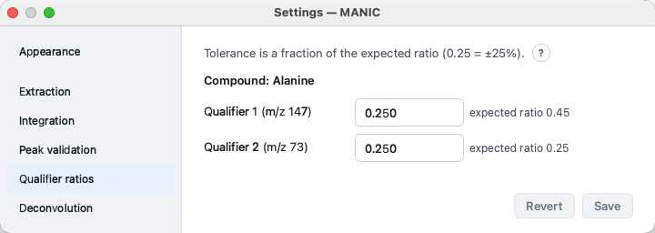

In unlabelled mode, Identity QC checks a qualifier ion only when it has an expected ratio and a tolerance. Expected ratios come only from the compound list, in the `Qualifier 1 Ratio` and `Qualifier 2 Ratio` columns (qualifier area / Q area). A missing tolerance does not need a reload: set it in **Settings → Qualifier ratios**.

To add an expected ratio:

1.  Fill the compound's `Qualifier 1 Ratio` or `Qualifier 2 Ratio` cell in the compound list file and save the file.
2.  Choose **File → Clear Session** and confirm.
3.  Load the compound list, then the raw data, again.

Clear Session also removes the review work in the session: integration changes, peak reviews, curve-fit choices, tolerances set in Settings, the internal standard and compounds added with **Add Compound**. Add missing ratios before you review. Importing a session exported earlier restores the ratios saved in it, so export a new session after the reload.

---

## Step 4b: Managing Samples and Compounds

### Deleting Items

You can delete samples or compounds directly from their respective list widgets.

**Procedure**

1.  Locate the **Samples** or **Compounds** list in the left sidebar. Expand **Samples** first if it is collapsed.
2.  **For samples:** Select one or more items using `Ctrl` (Windows/Linux) or `Cmd` (Mac) + click.  
    **For compounds:** Select a single item (compounds use single-selection).
3.  **Right-click** on your selection.
4.  Select **"Delete Sample"** / **"Delete N Samples"** or **"Delete Compound"** from the context menu.
5.  Confirm the deletion in the dialog that appears.

**Important Notes**

*   You cannot delete *all* samples or *all* compounds. At least one must remain.
*   Deleted items are excluded from plots, calculations, and exports.
*   Deleting the internal standard compound clears the internal standard. Recovering that compound does not select it again; choose it again from the **Internal standard** row.
*   Deletion is reversible. See below.

### Recovering Deleted Items

Deleted items are not permanently removed. They are "soft deleted" and can be restored at any time during your session.

**Procedure**

1.  **Right-click** anywhere in the **Samples** or **Compounds** list.
2.  Select **"Recover Deleted Samples..."** or **"Recover Deleted Compounds..."**.
    *   *This option is grayed out if no items have been deleted.*
3.  In the recovery dialog, select the items you wish to restore (multi-select is supported).
4.  Click **Restore selected**. With nothing deleted, the dialog says **No deleted samples** or **No deleted compounds**; click **Close**.

Restored items will immediately reappear in their respective lists and be included in subsequent analyses and exports.

### Deleted Items in Exports

When you export data, the changelog file will include a **"Deleted Items"** section listing any compounds or samples that were excluded. This provides a complete audit trail of what was, and was not, included in your final results.

---

## Step 5: Export Results

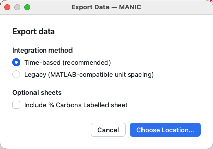

**Prerequisites**   

**Data Validity:** Ensure required metadata (especially `int_std_amount` and `amount_in_std_mix`) is present for calibrated compounds.

* **Note on Standards:** While an Internal Standard is recommended for "nmol" results, you may proceed without one to export raw **Peak Areas**.

**Procedure**   

1.  Navigate to **File → Export Data...**.
2.  In **Export Data**, choose the integration method for this workbook:
    * **Time-based (recommended):** Peak areas use actual time units (intensity × minutes). This is the default.
    * **Legacy (MATLAB-compatible unit spacing):** Unit-spacing integration (sum of intensities). Use this only if you need to match numerical values from the legacy MATLAB tool (values will be about 100× larger).

    In labelled mode the same dialog has **Include % Carbons Labelled sheet**, off by default. Click **Choose Location…**.
3.  In the file dialog, choose a name and location for your output file (e.g., `experiment_results.xlsx`) and click **Save** to begin processing.
4. If no internal standard is selected, a warning explains that results will be exported as unnormalized peak areas. Click **Export** to proceed.

> **Note on Processing:** MANIC will perform a final check to ensure natural isotope corrections have been applied. If not, a progress bar will appear as it calculates these corrections for all labeled compounds to ensure data integrity.

**Output Files**   

The export generates two files in your selected directory:

1.  **Data File (`.xlsx`):** The multi-sheet workbook containing your results.
2.  **Changelog (`changelog_YYYYMMDD_HHMM.md`):** A text file documenting the exact parameters used for this analysis, including software version, date, the mass tolerance (Da) and peak-validation threshold, any deleted items excluded from export, and a table of all session-specific integration overrides. This serves as an audit trail for reproducibility.

**Workbook Structure**   

The Excel file contains five worksheets by default. A sixth sheet is optional.

| Worksheet | Description |
| :--- | :--- |
| **1. Raw Values** | Direct instrument signals (uncorrected peak areas). Useful for quality control and verifying raw signal strength. |
| **2. Corrected Values** | Peak areas after mathematical removal of natural isotope abundance. This is the "clean" signal representing true experimental labeling. (If chromatographic deconvolution is enabled, this correction is applied to the same selected component used for Raw Values. If any ion with real intensity failed to fit, both sheets use the raw in-window scans for every non-empty ion. Empty ions stay at area 0 and do not force that fallback.) |
| **3. Isotope Ratio** | Normalized distributions where all isotopologues for a compound sum to 1.0. Used for comparing labeling patterns independent of concentration. |
| **4. % Label Incorporation** | The percentage of the metabolite pool that has incorporated the experimental label. Includes background correction derived from MM files (standard mixture). |
| **5. Abundances** | Absolute amounts (nmol), Relative ratios, or raw Peak Areas depending on standard selection. |
| **% Carbons Labelled** (optional) | Off by default. Tick **Include % Carbons Labelled sheet** in **Export Data** to add the weighted average enrichment of the total carbon pool. |

**Validation & Errors**   

* **Invalid Peaks:** Cells corresponding to peaks that failed the minimum area validation (plots with a **Below threshold** badge) will be highlighted with a **light red background** in the Excel file.
* **Abundance Errors:** If the internal standard is missing required calibration fields (`int_std_amount` or `amount_in_std_mix`), MANIC will prompt you to either **cancel** and fix the compound list, or **continue** in unnormalized **Peak Area** mode for that export.

---

## 6. Session Management

### Clear Session vs New Analysis Session

**File → Clear Session** removes compound data, raw data, and session settings. The window stays in the current analysis mode. Confirm **Clear Session**. When it finishes, **Session cleared** appears.

**File → New Analysis Session...** opens **Choose Analysis Mode**. Click **Labelled** or **Unlabelled**. If you pick the mode you are already in, MANIC tells you to use **Clear Session** instead. If you pick the other mode and data is loaded, confirm **New Analysis Session**. MANIC then clears the database and opens a new window.

MANIC can save the state of your analysis, including compound definitions, integration boundaries, and manual overrides, without duplicating the large raw data files.

### Export Session
**File → Export Session...**

* **Function:** Creates a `.json` file containing your analytical method and a human-readable changelog.
* **What is saved:** Compound library, retention times, all integration offsets (global and sample-specific), each compound's processing settings (baseline correction and deconvolution level, fit type, and noise gate), the selected internal standard, the labelled internal-standard reference peak (M+N), the mass tolerance (Da), and the peak-validation threshold.
* **What is NOT saved:** The raw mass spectrometry data (CDF content).
* **Use Case:** Archiving your analysis method or sharing it with a colleague who has the same raw files.

### Import Session
**File → Import Session...**

* **Function:** Applies saved integration parameters and per-compound processing settings to the currently loaded data.
* **Workflow:**
    1.  Load your Compound List (Step 1).
    2.  Load your Raw Data CDFs (Step 2).
    3.  **Import Session** to apply the saved boundaries, overrides, deconvolution/baseline settings, internal standard, mass tolerance, and peak-validation threshold. If the saved mass tolerance differs from the current one, MANIC regenerates every EIC, as it does when you change it in **Settings**.
* **Moved peak windows:** Where a saved tR or offset puts the peak window outside the data extracted for a sample, the import re-extracts that sample from its CDF file, as **Apply** does. You do not need to click **Apply** on each compound. If a CDF file has moved, the import names the compounds it could not re-extract.
* **Backward compatibility:** Older session files that predate the deconvolution settings or the internal-standard keys import without error. Compounds keep their current settings for any value the file does not contain. A file with no internal-standard key leaves the current internal standard unchanged, unless the file marks that compound as deleted. Then the internal standard is cleared. A file with no mass tolerance or peak-validation threshold keeps the current Settings values.

---

## 7. Advanced Visualization

### Plot right-click menu

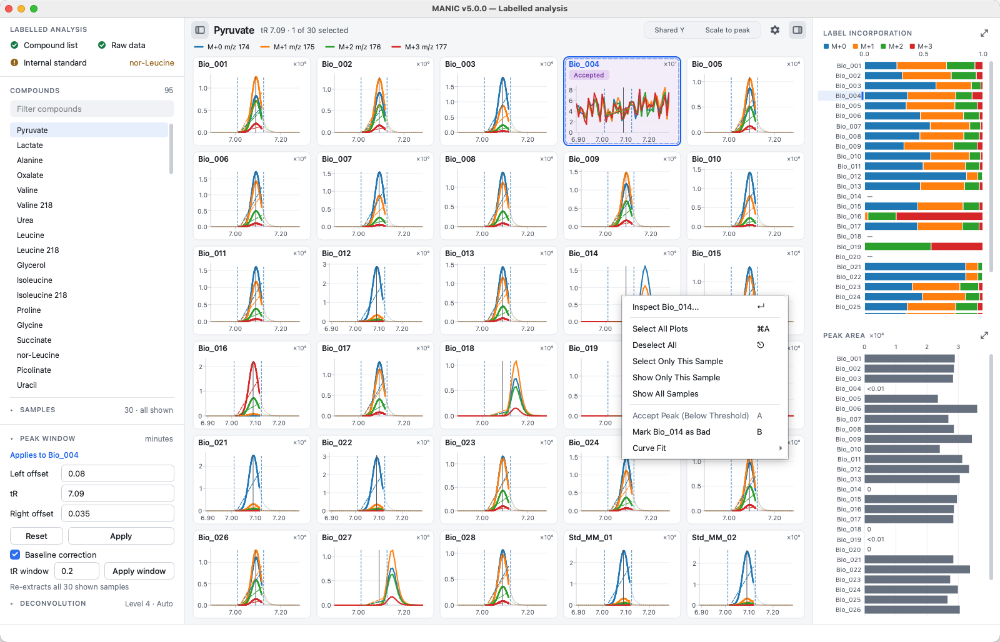

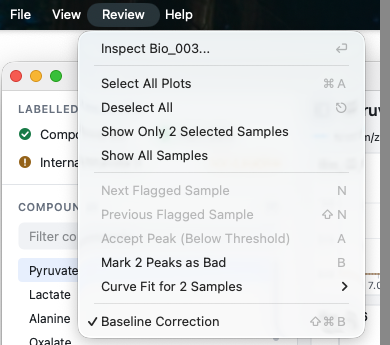

Right-click a plot for these commands. The **Review** menu in the menu bar offers the same review commands with the same labels and counts.

* **Select All Plots**
* **Deselect All**
* **Select Only This Sample**
* **Show Only Selected Samples**
* **Show All Samples**
* **Inspect *sample*...**
* **Accept Peak (Below Threshold)**
* **Mark Peak as Bad**
* **Curve Fit** (submenu)

**Select Only This Sample**, **Inspect *sample*...**, **Accept Peak (Below Threshold)**, **Mark Peak as Bad**, and **Curve Fit** need a plot under the pointer. When that plot is selected, the review commands act on every selected plot and name the count, for example **Mark 3 Peaks as Bad** or **Curve Fit for 3 Samples**. **Show Only Selected Samples** needs at least one selected plot. On a plot outside the selection it reads **Show Only This Sample** and shows that plot alone.

### Detailed Sample View

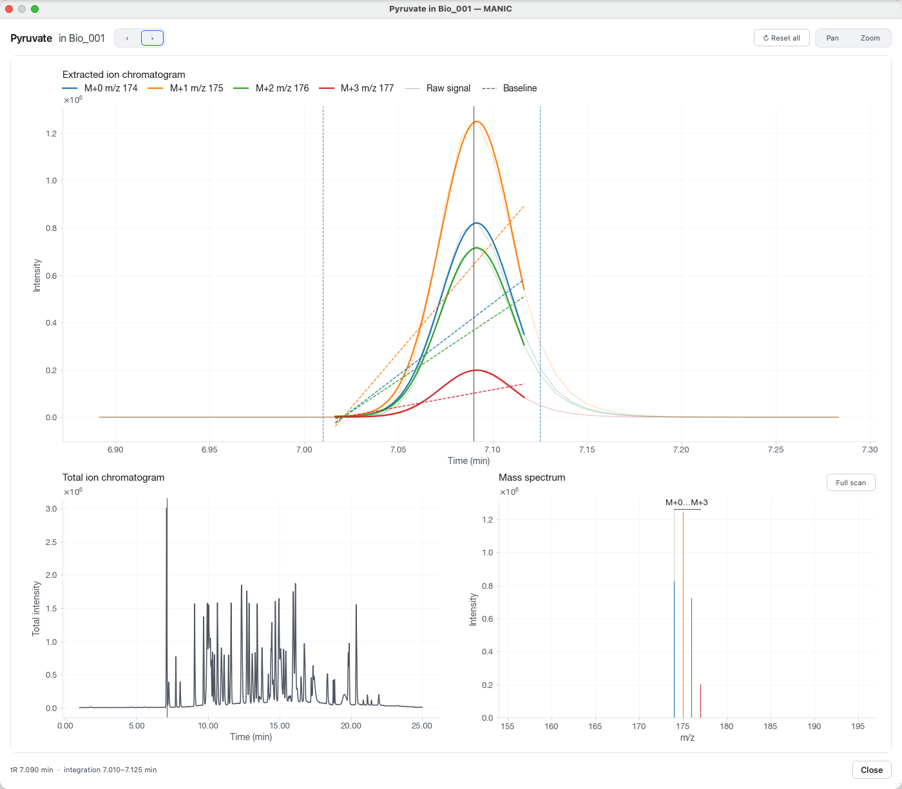

Right-click any plot in the main grid and select **Inspect *sample*...**, or double-click the plot, to open the inspection window. This view is essential for verifying peak purity and identity.

* **Extracted ion chromatogram (EIC):** The specific trace for the target compound, showing the integration window boundaries.
* **Total ion chromatogram (TIC):** The global chromatogram for the sample, useful for checking if a peak shifted relative to major markers.
* **Mass spectrum:** The actual mass spectrum at the peak's retention time. Use this to confirm the spectral fingerprint matches your metabolite.

Use the **‹ ›** buttons in the header, or the left and right arrow keys, to move to the previous or next sample in grid order without closing the window.

### Summary Panel

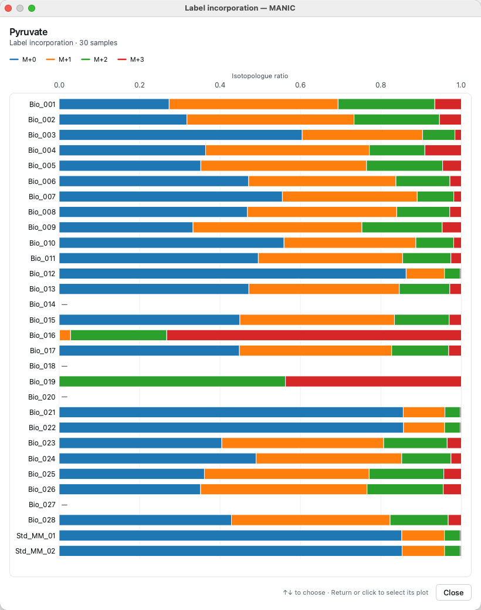

The **Summary** panel on the right of the plot grid shows two charts, one above the other: **Isotopologue ratio** and **Peak area**. In unlabelled mode, **Identity** replaces Isotopologue ratio.

**Isotopologue ratio** splits each sample's bar into each isotopologue's share (M+0, M+1, ...) of its total area. With **Show corrected data** ticked, the shares match the **Isotope Ratio** sheet. Unticked (the default), they come from raw areas. The chart is not **% Label Incorporation**, which also subtracts the MM background.

* **Show or hide:** Click the panel button at the top right of the grid, or choose **View → Show Summary** (Ctrl+Alt+R, ⌥⌘R on macOS). Drag the panel's left edge to resize it. MANIC remembers both. The panel opens on its own only in a window with room for three columns of plots beside it. Narrowing the window past that closes it, and widening it again brings it back. You can still open it in a narrower window, as long as two columns of plots fit.
* **Enlarge:** Click the expand button (↗) at the top right of either chart, or **double-click** the chart, to open it in a large, interactive popup window.
* **Rows:** Both charts name every sample. When a run has more samples than the panel has room for, the chart scrolls; selecting plots in the grid scrolls it to their bars. Click a row to select that sample's plot.

The button at the top left of the grid, or **View → Show Sidebar** (Ctrl+Alt+S, ⌥⌘S on macOS), hides the sidebar so the grid takes its width. **Find Compound** and **View → Sample List** show it again.

---

## 8. Settings & Configuration

On Windows, **Settings...** is in the **File** menu, and **Documentation**, **Check Data Setup**, **Check for Updates** and **About** are in the **Help** menu. On macOS, **Settings** and **About** sit in the **MANIC** application menu and the other three under **Help**. The gear icon at the top right of the plot area opens Settings too.

**Shortcuts.** **Settings...** is Ctrl+, and **Documentation** is F1. On macOS they are ⌘, and ⌘?.

Settings has one page per topic: **Appearance**, then **Extraction**, **Integration**, **Internal standard**, **Peak validation**, **Natural abundance** and **Deconvolution**. **Internal standard** and **Natural abundance** are labelled-only; unlabelled mode adds **Qualifier ratios**. **Save** writes the changed values on the page you are on and **Revert** discards them. A dot in the page list marks a page with unsaved changes.

**Settings → Appearance** sets the **Theme**: **System** (default) follows the OS light or dark mode, **Light** and **Dark** override it. It applies as soon as you choose it, without Save, and MANIC remembers it.

### Mass Tolerance
**Settings → Extraction**, **Mass tolerance (Da)**

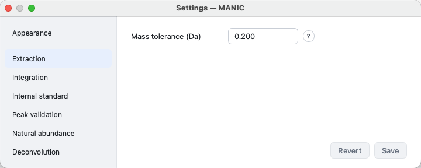

* **Default:** `0.2 Da`
* **Function:** Defines the binning width for extracting ion chromatograms. MANIC uses an asymmetric "offset-and-round" algorithm to correct for mass calibration drift.
* **Impact:** If CDFs are loaded, the change regenerates every EIC. You do not re-import the folder.
* **Reference:** [Mass Tolerance](Reference_Mass_Tolerance.md)

### Integration
**Settings → Integration**

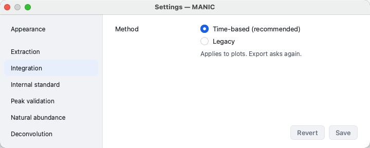

* Two **Method** radios: **Time-based (recommended)** (default) and **Legacy**.
* The choice changes on-screen peak areas only.
* Export asks again in **Export Data**. Those radios are **Time-based (recommended)** and **Legacy (MATLAB-compatible unit spacing)**.
* **Reference:** [Compare Integration Methods](Reference_Integration_Methods.md)

### Minimum Peak Area
**Settings → Peak validation**, **Minimum area ratio**

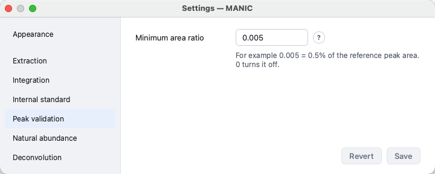

* **Default:** `0.005` (0.5%)
* **Function:** Sets the validation threshold. Peaks with a total area less than 0.5% of the Internal Standard's area get a light red **Below threshold** badge.
* **Reference:** [Understanding Peak Validation](Reference_Peak_Validation.md)

### Baseline Correction
The **Baseline correction** checkbox is in the **Peak window** section of the sidebar, under the **tR window** field. **Review → Baseline Correction** toggles it too.

* **On (Default):** Subtracts a linear baseline from each peak area. A dashed line will appear on plots showing the fitted baseline.
* **Off:** Uses the raw integrated area without baseline subtraction.
* **Scope:** This is a per-compound setting. Toggling it affects all samples for the selected compound.
* **Reference:** [Baseline Correction Algorithm](Reference_Baseline_Correction.md)

### Y-axis scale
Two toggles in the grid header, **Shared Y** and **Scale to peak**, set how sample tiles scale. The **View** menu has the same commands. MANIC remembers the last choice.

* **Shared Y** / **View → Shared Y-Scale** (Ctrl+Shift+Y, ⌘⇧Y on macOS): one intensity scale for every sample tile.
* **Scale to peak** / **View → Scale to Selected Peak** (Ctrl+Shift+P, ⌘⇧P on macOS): each tile uses that sample's selected deconvolution component (the peak nearest tR). Other peaks in the extract may clip. Labelled mode only.
* Only one can be on. Both off is the default. Each tile then autoscales to the tallest intensity in its extract.

### Chromatographic Peak Deconvolution
**Sidebar → Deconvolution**, or **Settings → Deconvolution**

The **Deconvolution** section of the sidebar, under **Peak window**, shows the selected compound's **Resolution**, **Fit type** and **Noise gate**. A pick there is saved for that compound at once and the plots redraw, so you can try a level and see the result. Collapsed, its heading names the setting, for example **Level 4 · Auto** or **Off**. **Apply to all compounds** and the **Per-sample curve fit** table are on the Settings page.

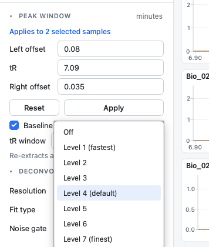

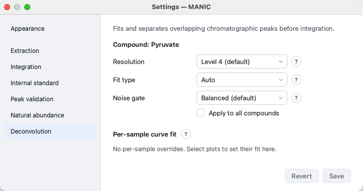

* **Default:** `Level 4`, `Auto` fit type
* **Function:** Fits chromatographic peak shapes around the expected retention time and selects the component nearest that time whose centre sits inside the dashed loffset/roffset window. This can separate overlapping peaks before area calculation.
* **Scope:** This is a **per-compound** setting. Open **Settings → Deconvolution** with a compound selected; the chosen resolution level and fit type are saved for that compound and used by every sample that does not have its own override. A sample can override the curve fit from the plot right-click menu or from the **Per-sample curve fit** table on the same settings page. An override is shown on that tile's caption. See [Per-sample curve fit](Reference_Chromatographic_Peak_Deconvolution.md#per-sample-curve-fit).
* **Tiles in view do not limit Save:** The compound setting still applies to every sample of that compound, including samples you are not plotting. A per-sample curve-fit override is the exception.
* **Resolution levels:** `Off` disables the feature. Levels `1` through `7` increase chromatographic resolution; higher levels allow narrower and weaker overlapping components to be considered (and cost more time). The default `Level 4` is tuned for aggressive splitting of resolved overlaps while staying fast; levels `5`-`7` additionally enable shoulder detection (separating components that ride on a flank without their own peak) for the hardest coelutions.
* **Fit type:** Choose how the elution shape is modelled:
    * `Auto` - compares the candidate shapes and picks the best by BIC (recommended default).
    * `Gaussian` - symmetric peaks only.
    * `Bi-Gaussian` - asymmetric peaks with separate left/right widths.
    * `EMG` - exponentially modified Gaussian for tailing peaks.
* **Each fittable ion is fitted on its own.** When the level is not `Off`, MANIC fits each channel independently. Overlaps are split and the in-window component nearest the expected retention time is kept. A well-resolved single peak becomes a one-component model so that ion uses the same measurement as any sibling that needed a split. Set the level to `Off` to always integrate the raw trace.
* **Noise gate:** Controls how aggressively MANIC skips fitting on messy/noise-only peaks. When a window is skipped it shows and integrates the plain raw trace instead of drawing a meaningless fitted curve - which also keeps exports fast, since noise-only traces are otherwise the slowest to (pointlessly) fit. This is a per-compound setting with four presets:
    * `Balanced` - skip noise and weak peaks buried in heavy noise (recommended default).
    * `Lenient` - skip only near-pure noise.
    * `Aggressive` - only fit clearly smooth peaks.
    * `Off` - always attempt a fit (the old behaviour).
* **Apply to all compounds:** The page has an **"Apply to all compounds"** checkbox. Tick it to copy the chosen resolution, fit type, and noise gate to *every* compound at once (after a confirmation prompt). This is the quickest way to, for example, turn deconvolution **off everywhere** (select `Off`, tick the box, confirm) or roll one configuration out across your whole method. Note that this overwrites each compound's existing per-compound settings.
* **Affects raw, corrected, and abundance results:** When every non-empty ion of a compound in a sample fitted, the *same* selected component is used for the Raw Values, the natural-abundance Corrected Values, and the Abundances. Turning deconvolution on or off for a compound therefore moves all of its result sheets together (not just the raw areas).
* **One noisy failed ion puts the whole envelope on scans:** If any isotopologue with real intensity cannot be fitted, plots show the raw scan traces and export integrates those same raw in-window scans for every non-empty ion of that pair on both Raw and Corrected. An ion with no positive signal inside the dashed boundaries is empty, not a failed fit. Signal elsewhere in the chromatogram does not change that. A successful fit with no peak centre inside the boundaries is also empty. Empty ions stay at area 0. Weak positive ions use their raw scans if fitting fails.
* **Status indicator:** When the selected compound's setting differs from the default (level 4, automatic peak shape, balanced noise gate), the right side of the bottom status bar names it, e.g. `Deconvolution level 2 · EMG peaks · balanced noise gate` or `Deconvolution off`. Click it to open **Settings → Deconvolution**.
* **Logging:** The per-compound resolution, fit type, and noise gate are recorded in the export changelog so processed results are reproducible.
* **Reference:** [Chromatographic Peak Deconvolution](Reference_Chromatographic_Peak_Deconvolution.md)

### Natural Abundance Correction
**Settings → Natural abundance**

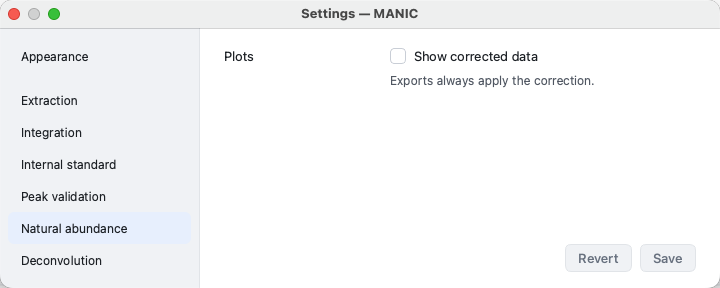

* Checkbox: **Show corrected data**. Off by default.
* **Function:** Controls what the main chromatogram plots and the Isotopologue ratio bars show.
    * Ticked: Fits the **raw** traces, then draws natural-abundance correction of that same measurement at the acquisition scan times. If the compound has no correction formula or labelled atoms, the plot keeps the raw fitted view. A sample with a fitted curve keeps that curve in either case. Heights can change after correction. When deconvolution selects a fitted component, the faint raw EIC remains visible for context, including neighbour peaks outside that component. Those neighbours do not enter correction or integration.
    * Unticked: Draws the raw EIC. If deconvolution fitted, the faint raw trace stays under the curve.
* **Usage:** Toggle this to check how correction redistributes the isotopologue signals.
* **Note:** This setting only affects the *display* and the on-screen bars. Export still writes both Raw and Corrected sheets from the raw fit, then correction of that selected component. Time-based export uses a denser evaluation of the fit for a more accurate area.
* **Reference:** [Natural Isotope Correction Algorithm](Reference_Natural_Isotope_Correction.md)

---

## 9. Special Workflow: Process External Data

**File → Process External Data...**, or **Rebuild an export without CDF files…** on the labelled start screen

Rebuild a labelled export from the "Raw Values" (integrated peak areas) of an old experiment, from the legacy MANIC tool (v3.3.0) or a previous MANIC export, when you **do not** have the original raw CDF files (or do not wish to re-integrate them). The rebuild uses the current natural abundance correction and MRRF algorithms.

**Prerequisites**

1.  **Old Results File:** An Excel (`.xlsx`) workbook with a **Raw Values** sheet of uncorrected peak areas. CSV files are not accepted.
2.  **Compound List:** A labelled compound definition file (see Step 1), with **mass0** and **labelAtoms** columns, that matches the metabolites in your old results. This is required to provide the molecular formulas and atom counts needed for the new correction math.

**Procedure**

1.  Choose **File → Process External Data...**, or click **Rebuild an export without CDF files…** on the labelled start screen.
2.  In **Process external data**, set **Compounds file** with **Browse…**.
3.  Set **Raw Values workbook** with **Browse…**.
4.  Optionally click **Internal standard** and choose one, typing to filter. It lists the compounds once a compounds file is chosen. A standard without both `int_std_amount` and `amount_in_std_mix` is listed under **No amount: exports peak areas**, and choosing it writes **Peak Area** abundances.
5.  Click **Rebuild export…**.
6.  In **Save Rebuilt Export**, choose the output workbook and save.

**How It Works**

MANIC reads the raw areas from the workbook, pairs them with the compound list, and writes five sheets: **Raw Values**, **Corrected Values**, **Isotope Ratio**, **% Label Incorporation**, and **Abundances**.

> **Scientific limitation: Approximate Mode**
>
> Because the original raw data (CDF) is missing, MANIC cannot perform the standard "per-timepoint" correction. Instead, it applies a mathematical approximation to the **total integrated area**.
>
> * **Result:** The "Corrected Values" may differ slightly from a full re-analysis of raw CDFs.
> * **Restriction:** You cannot adjust integration boundaries or view chromatograms in this mode.

**Full explanation:** [Process External Data](Workflow_Process_External_Data.md)

---

## Appendix: Migration from version 3

For users upgrading from the MATLAB version of MANIC (v3.3.0), please note the following critical changes in data handling.

| Feature | v3.3.0 (Legacy) | v4.0.0 (Python) |
| :--- | :--- | :--- |
| **Integration** | Unit-spacing (large values) | Time-based (physically meaningful). *Legacy mode available.* |
| **NA Correction** | Applied *after* integration | Applied *before* integration (per timepoint) for higher accuracy. |
| **MRRF** | Sum-based calculation | Mean-based calculation (more robust to sample count variations). |
| **Validation** | Manual visual check | Automatic **Below threshold** badges on weak peaks. |

* **Correction Math:** [Natural Isotope Correction Algorithm](Reference_Natural_Isotope_Correction.md)

## Glossary

**Internal standard.** The compound chosen from the sidebar **Internal standard** row or with **Select as Internal Standard**. The row shows that name. With no selection it shows **None**. **Settings → Internal standard** shows the same name.

**MM files (standard mixture).** Sample files that match the compound-list `mmfiles` pattern. MANIC uses them for MRRF and background correction.

**Corrected (natural-abundance).** Peak areas after removal of naturally occurring heavy isotopes. This is not the same as **Baseline-corrected**, which subtracts a linear baseline from the chromatogram before area is taken.

**nmol, Relative, Peak Area.** Units on the **Abundances** sheet. nmol when an internal standard and `amount_in_std_mix` are set. Relative when an internal standard is set but `amount_in_std_mix` is missing or 0. Peak Area when no internal standard is selected.

**Below threshold.** The light red tile badge for a peak whose total area is below the peak-validation threshold (default 0.5% of the internal standard reference peak).
